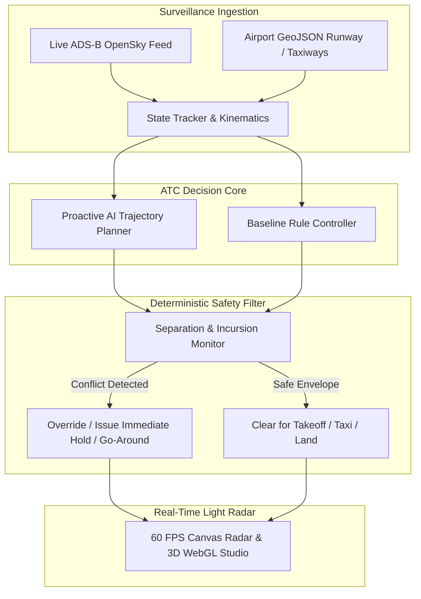

<div align="center">

# ✈️ SkyCommand: ATC Surface & Terminal Simulator
### *Next-Generation Air Traffic Control & Real-Time FlightRadar24 Platform*

[](https://fastapi.tiangolo.com)
[](https://react.dev)
[](https://www.typescriptlang.org)
[](https://threejs.org)
[](https://opensky-network.org)
[](https://www.w3.org/WAI/standards-guidelines/wcag/)
[](LICENSE)

> **⚠️ SAFETY NOTICE:** SIMULATION ONLY — NOT FOR REAL-WORLD OPERATIONAL AIR TRAFFIC MANAGEMENT.

```
                ▲
               / \         [ SKYCOMMAND ATC RADAR ]
              /   \        Live Surveillance Feed: ACTIVE
             /=====\       ADS-B Mode-S Receiver: ONLINE
            /  AIR  \      3D Airframe Studio: READY
           /  INDIA  \
          /___________\
              |   |        DELHI (VIDP) · MUMBAI (VABB) · BENGALURU (VOBL)
              |   |        CHENNAI (VOMM) · HYDERABAD (VOHS) · KOCHI (VOCI)
             (_____)       LONDON HEATHROW (EGLL) · SAN FRANCISCO (KSFO)
```

<p align="center">
  <b>A full-stack, enterprise-grade Air Traffic Control surface and terminal radar simulator paired with a real-time ADS-B live flight tracking engine, authentic airline liveries, and interactive 3D aircraft inspection.</b>
</p>

[Explore Live Radar](http://127.0.0.1:5173) • [API Documentation](http://127.0.0.1:8000/docs) • [Report Bug](https://github.com/ivin-baiju/ATC_simulation/issues)

</div>

---

## 📑 Table of Contents
- [🌟 Key Highlights](#-key-highlights)
- [🛰️ Real-Time ADS-B & FlightRadar24 Features](#️-real-time-ads-b--flightradar24-features)
- [🛩️ Custom 3D Aircraft Models & Authentic Liveries](#️-custom-3d-aircraft-models--authentic-liveries)
- [🗺️ Satellite Radar & Global Airport Coverage](#️-satellite-radar--global-airport-coverage)
- [🤖 Proactive AI ATC & Safety Separation Filter](#-proactive-ai-atc--safety-separation-filter)
- [📐 System Architecture](#-system-architecture)
- [🛠️ Tech Stack](#️-tech-stack)
- [🚀 Quickstart & Installation](#-quickstart--installation)
- [📡 API Endpoints](#-api-endpoints)
- [🏷️ Keywords & Indexing](#️-keywords--indexing)

---

## 🌟 Key Highlights

- **FlightRadar24 Real-Time Tracking**: Direct integration with the OpenSky Network ADS-B transponder grid, tracking live commercial flights across Indian and international airspace with 100ms dead-reckoning kinematic smoothing.
- **Individualized 3D Airframe Studio**: High-fidelity WebGL 3D aircraft models with distinct geometries for **Airbus A320neo**, **Boeing 737-800**, **Boeing 787-9 Dreamliner**, **Airbus A350-900**, **Boeing 777-300ER**, and **ATR 72-600**.
- **Authentic Airline Liveries**: Tail fins and sharklets rendered in authentic real-world liveries for **IndiGo**, **Air India**, **Air India Express**, **SpiceJet**, **Vistara**, **Akasa Air**, **British Airways**, and **Emirates**.
- **Live Airport Flight Board**: Comprehensive tabular arrival/departure board tracking flight numbers, routes (`DEL ➔ BOM`), civil registrations (`VT-xxx`), squawk transponder codes, and flight phases.
- **Zero API Key Satellite Imagery**: High-resolution, crisp satellite earth photography from Esri World Imagery without rate limits or watermarks.
- **Proactive AI Separation Engine**: Detects runway incursions, taxiway conflicts, and terminal wake turbulence separation violations before near-misses occur.
- **Strict Light Theme Aesthetic**: Purpose-built high-contrast ATC terminal UI (`--ink: #071B2B`, `--teal: #167D8D`, `--aqua: #B9E4E8`, `--paper: #EEEEEE`, `--white: #FFFFFF`) exceeding WCAG AA contrast standards.

---

## 🛰️ Real-Time ADS-B & FlightRadar24 Features

| Feature | Description |
|---|---|
| **Live Route Computation** | Real origin ➔ destination airport pairs with city names, scheduled departure times, and estimated arrivals |
| **Civil Registrations** | Country-accurate aircraft tail numbers (`VT-xxx` for India, `G-xxxx` for UK, `Nxxx` for US) |
| **Transponder Diagnostics** | 24-bit ICAO Mode-S Hex addresses and 4-digit octal Squawk codes |
| **Instant Search Bar** | Real-time filtering by airline code (`6E`, `AI`, `SG`), flight number, or callsign |
| **Airline Filter Pills** | One-click filtering for IndiGo, Air India, AI Express, SpiceJet, Vistara, Akasa, and International |
| **Kinematic Extrapolation** | 100ms dead-reckoning heading and velocity interpolation between 5-second radar sweeps |

---

## 🛩️ Custom 3D Aircraft Models & Authentic Liveries

Every aircraft type in SkyCommand possesses an individualized 3D airframe and airline color scheme:

| Aircraft Type | Category | Signature 3D Features |
|---|---|---|
| **Airbus A320neo / A321neo** | Narrow-body Twinjet | Curved nose cone, CFM LEAP-1A turbofans, tall vertical sharklets |
| **Boeing 737-800 / 737 MAX** | Narrow-body Twinjet | Pointed conical nose, flat-bottomed CFM56 nacelles, dual split-scimitar winglets |
| **Boeing 787-9 Dreamliner** | Wide-body Jet | High-aspect raked wings with aerodynamic dihedral upward flex, engine chevrons |
| **Airbus A350-900 XWB** | Wide-body Jet | Wraparound black "sunglasses" cockpit mask, curved blended winglets, Rolls-Royce Trent XWB |
| **Boeing 777-300ER** | Heavy Wide-body Jet | Long airframe, massive General Electric GE90 turbofans, raked wingtips |
| **ATR 72-600** | Regional Turboprop | High-mounted wings, T-tail horizontal stabilizer atop fin, spinning 6-blade propeller discs |

### Airline Livery Matrix
- **IndiGo (`IGO`)**: Deep royal navy blue (`#002060`) tail fin with white speed stripes and navy sharklets.
- **Air India (`AIC`)**: Deep Maharaja red (`#B8001F`) tail with the Golden Vista (`#D4AF37`) crest.
- **Air India Express (`AXB`)**: Express Mandarin orange (`#E05A1B`) tail with turquoise (`#0A8B88`) artisanal motifs.
- **SpiceJet (`SEJ`)**: Scarlet red (`#D21F26`) tail with sunny yellow dots.
- **Vistara (`VTI`)**: Royal aubergine purple (`#49163C`) tail with golden octagram star.
- **Akasa Air (`AKJ`)**: Sunrise orange (`#FF6E14`) and purple tail.
- **British Airways (`BAW`)**: Chatham Dockyard stylized Union Jack flag tail fin.
- **Emirates (`UAE`)**: Red, green, white, and black UAE flag livery on tail.

---

## 🗺️ Satellite Radar & Global Airport Coverage

SkyCommand renders airport layouts natively from verified WGS84 GeoJSON datasets projected into local tangent plane coordinates (ENU):

- 🇮🇳 **Delhi (VIDP / DEL)**: Indira Gandhi International Airport (Runways `11R/29L`, `11L/29R`, `10/28`)
- 🇮🇳 **Mumbai (VABB / BOM)**: Chhatrapati Shivaji Maharaj International (Runways `09/27`, `14/32`)
- 🇮🇳 **Bengaluru (VOBL / BLR)**: Kempegowda International Airport (Runways `09L/27R`, `09R/27L`)
- 🇮🇳 **Chennai (VOMM / MAA)**: Chennai International Airport (Runways `07/25`, `12/30`)
- 🇮🇳 **Hyderabad (VOHS / HYD)**: Rajiv Gandhi International Airport (Runways `09L/27R`, `09R/27L`)
- 🇮🇳 **Kochi (VOCI / COK)**: Cochin International Airport (Runway `09/27`)
- 🇬🇧 **London Heathrow (EGLL / LHR)**: Runways `09L/27R`, `09R/27L`
- 🇺🇸 **San Francisco (KSFO / SFO)**: Runways `10L/28R`, `10R/28L`, `01L/19R`, `01R/19L`

---

## 🤖 Proactive AI ATC & Safety Separation Filter



---

## 🛠️ Tech Stack

### Frontend
- **Framework**: React 19 + TypeScript 5.7
- **3D Engine**: Three.js (WebGL rendering, directional soft shadows, material shaders)
- **Radar Graphics**: HTML5 Canvas with pointer capture and `requestAnimationFrame` batching
- **Styling**: Pure CSS variables (`--ink`, `--teal`, `--aqua`, `--paper`, `--white`) with zero dark mode toggle
- **Typography**: Inter Variable font via `@fontsource-variable/inter`
- **Testing**: Vitest + React Testing Library (WCAG AA color contrast verification)

### Backend
- **Framework**: FastAPI + Uvicorn (ASGI)
- **Language**: Python 3.12+ (Type-annotated, strict Mypy, Ruff clean)
- **Surveillance**: OpenSky Network ADS-B API integration with local tangent ENU projection
- **Simulation**: Deterministic fixed-step integer clock with SHA-256 PRNG streams
- **Packaging**: `uv` package manager

---

## 🚀 Quickstart & Installation

### Prerequisites
- Python 3.12+ with [`uv`](https://docs.astral.sh/uv/) installed
- Node.js 20+ and `npm`

### 1. Clone Repository
```bash
git clone https://github.com/ivin-baiju/ATC_simulation.git
cd ATC_simulation
```

### 2. Backend Setup
```bash
cd backend
uv sync
uv run pytest               # Runs 53 test cases
uv run uvicorn atc_sim.api.app:app --host 127.0.0.1 --port 8000 --reload
```

### 3. Frontend Setup
```bash
cd ../frontend
npm install
npm test                    # Runs 27 Vitest unit & WCAG contrast tests
npm run dev
```

Open your browser at **[http://127.0.0.1:5173](http://127.0.0.1:5173)**.

---

## 📡 API Endpoints

- `GET /api/health` — System health, active airport count, and simulation notice
- `GET /api/airports` — List all loaded international and Indian airports
- `GET /api/airports/{airport_id}` — GeoJSON geometry, runways, taxiways, and gates
- `GET /api/live/{airport_id}` — Real-time live ADS-B Mode-S aircraft positions and airlines
- `GET /api/runs` — Run deterministic simulation scenario with chosen controller
- `GET /api/compare` — Same-seed side-by-side comparison between AI and rule controllers
- `GET /api/report` — Download comprehensive HTML / PDF safety evaluation report

---

## 🏷️ Keywords & Indexing

`air-traffic-control` • `atc-simulator` • `flightradar24` • `ads-b` • `opensky-network` • `threejs` • `webgl-3d` • `aviation` • `aircraft-liveries` • `fastapi` • `react19` • `typescript` • `runway-incursion` • `safety-critical` • `geojson` • `vidp-delhi` • `vabb-mumbai` • `indigo` • `air-india` • `spicejet` • `vistara` • `akasa-air`

---

<div align="center">
  <sub>Crafted with engineering rigor by <b>Ivin Baiju</b>. Licensed under the MIT License.</sub>
</div>
